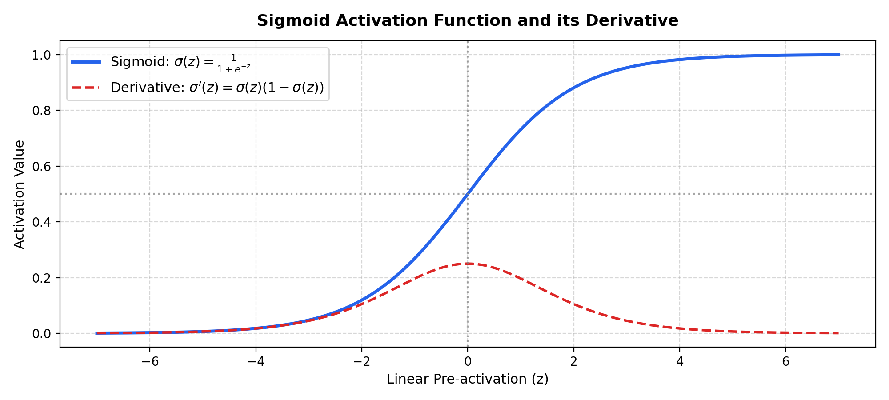

# Step 10: Sigmoid Neuron (From First Principles)

**Project Title:** Sign Language Recognition and Translation Assistant  
**Project Number:** Project 13  
**Domain:** Assistive Technology  
**Milestone:** Phase I — Step 10 (Continuous Differentiable Neurons)  
**Execution Date:** October 28, 2026  
**Implementation Languages:** Python & Modern C++11 (Zero-Dependency STL)  

---

## 1. Motivation: Overcoming the Limitations of the Step Function
In Step 9, we demonstrated that the McCulloch-Pitts neuron uses a hard Heaviside step function:
$$g(z) = \begin{cases} 1 & \text{if } z \ge \theta \\ 0 & \text{if } z < \theta \end{cases}$$
While capable of basic logic, the step function has a fatal flaw for machine learning: **its derivative is zero everywhere (and undefined at $z = \theta$)**.

$$\frac{d}{dz} g(z) = 0 \quad (\forall z \neq \theta)$$

Because gradients are zero, applying gradient descent is mathematically impossible. A small change in weights $\Delta w$ produces either zero change in output or a discontinuous jump. To enable automated learning via calculus, the discrete step function must be replaced by a **smooth, continuous, and everywhere-differentiable activation function: the Sigmoid (logistic) function**.

---

## 2. Mathematical Anatomy of the Sigmoid Neuron

```
Continuous Inputs (x_i in R)
      x1 ──(w1)──┐
                 ▼
      x2 ──(w2)──► [ Weighted Sum: z = Σ w_i * x_i + b ] ──► [ Sigmoid Activation: a = σ(z) ] ──► Output a in (0, 1)
                 ▲
      Bias (b) ──┘
```

1. **Continuous Inputs ($x \in \mathbb{R}^n$):** Accepts continuous real-valued inputs (such as normalized pixel intensities).
2. **Learnable Weights ($w \in \mathbb{R}^n$) and Bias ($b \in \mathbb{R}$):** Continuous parameters that scale inputs and shift the activation threshold along the axis.
3. **Linear Pre-Activation ($z$):**
   $$z = \sum_{i=1}^n w_i x_i + b = w^T x + b$$
4. **Sigmoid Activation Function ($\sigma(z)$):**
   $$a = \sigma(z) = \frac{1}{1 + e^{-z}}$$
5. **Output Range:** Strictly continuous open interval $(0, 1)$. In binary classification, $a$ directly represents the posterior probability:
   $$a = P(y = 1 \mid x)$$

---

## 3. Mathematical Proof of the Sigmoid Derivative
The derivative of $\sigma(z)$ with respect to $z$ expresses cleanly in terms of its own activation $a$:

$$\sigma(z) = (1 + e^{-z})^{-1}$$

Applying the chain rule:
$$\frac{d}{dz} \sigma(z) = -1(1 + e^{-z})^{-2} \cdot \frac{d}{dz}(1 + e^{-z})$$
$$= -1(1 + e^{-z})^{-2} \cdot (-e^{-z}) = \frac{e^{-z}}{(1 + e^{-z})^2}$$

Decomposing the fraction:
$$\frac{d}{dz} \sigma(z) = \left(\frac{1}{1 + e^{-z}}\right) \left(\frac{e^{-z}}{1 + e^{-z}}\right)$$
$$= \left(\frac{1}{1 + e^{-z}}\right) \left(\frac{1 + e^{-z} - 1}{1 + e^{-z}}\right) = \left(\frac{1}{1 + e^{-z}}\right) \left(1 - \frac{1}{1 + e^{-z}}\right)$$

$$\therefore \sigma'(z) = \sigma(z)(1 - \sigma(z)) = a(1 - a)$$

### Properties of the Derivative:
- **Maximum Gradient:** At $z = 0$, $\sigma(0) = 0.5$, yielding a peak derivative $\sigma'(0) = 0.5 \times (1 - 0.5) = 0.25$.
- **Vanishing Gradients at Extremes:** As $|z| \to \infty$, $\sigma(z) \to 0$ or $1$, causing $\sigma'(z) \to 0$ (saturation).



---

## 4. Why Differentiability Matters for Learning
Neural network parameters are updated by minimizing a loss function $\mathcal{L}$ using gradient descent:
$$w_i \leftarrow w_i - \eta \frac{\partial \mathcal{L}}{\partial w_i}, \quad b \leftarrow b - \eta \frac{\partial \mathcal{L}}{\partial b}$$

By the chain rule of calculus:
$$\frac{\partial \mathcal{L}}{\partial w_i} = \frac{\partial \mathcal{L}}{\partial a} \cdot \frac{\partial a}{\partial z} \cdot \frac{\partial z}{\partial w_i} = \frac{\partial \mathcal{L}}{\partial a} \cdot \left[\sigma(z)(1 - \sigma(z))\right] \cdot x_i$$

- **In the McCulloch-Pitts Neuron:** $\frac{\partial a}{\partial z} = 0$, so $\frac{\partial \mathcal{L}}{\partial w_i} = 0$. The parameters cannot learn from data.
- **In the Sigmoid Neuron:** $\frac{\partial a}{\partial z} = a(1 - a) \neq 0$. Gradients flow smoothly, enabling parameters to incrementally adjust until the loss is minimized.

---

## 5. Binary Cross-Entropy Loss & Optimization
For binary classification, the convex loss function is Binary Cross-Entropy (BCE):
$$\mathcal{L} = -\frac{1}{N} \sum_{k=1}^N \left[ y_k \ln(a_k) + (1 - y_k) \ln(1 - a_k) \right]$$

The derivative with respect to $a$ is:
$$\frac{\partial \mathcal{L}}{\partial a} = \frac{a - y}{a(1 - a)}$$

Combining with the sigmoid derivative $\frac{\partial a}{\partial z} = a(1 - a)$ gives the elegant gradient:
$$\frac{\partial \mathcal{L}}{\partial z} = \frac{\partial \mathcal{L}}{\partial a} \cdot \frac{\partial a}{\partial z} = \left(\frac{a - y}{a(1 - a)}\right) \cdot [a(1 - a)] = a - y$$

$$\frac{\partial \mathcal{L}}{\partial w_i} = \frac{1}{N} \sum_{k=1}^N (a_k - y_k) x_{k,i}, \quad \frac{\partial \mathcal{L}}{\partial b} = \frac{1}{N} \sum_{k=1}^N (a_k - y_k)$$

---

## 6. Empirical Verification Results

Both Python ([`src/fundamentals/sigmoid_neuron.py`](file:///c:/Users/16476/OneDrive/Desktop/SIGN%20LANGUAGE%20DETECTION%20AND%20TRANSLATION/src/fundamentals/sigmoid_neuron.py)) and native C++ ([`cpp/sigmoid_neuron.cpp`](file:///c:/Users/16476/OneDrive/Desktop/SIGN%20LANGUAGE%20DETECTION%20AND%20TRANSLATION/cpp/sigmoid_neuron.cpp)) implementations verified gradient descent convergence on the OR logic gate:

### Convergence History

| Epoch | Python BCE Loss | Native C++ BCE Loss | Weights $[w_1, w_2]$ | Bias $b$ |
|---|---|---|---|---|
| **0 (Init)** | $0.6843$ | $0.6450$ | $[0.10, 0.10]$ | $0.00$ |
| **50** | $0.0886$ | $0.0881$ | $[4.05, 4.04]$ | $-1.49$ |
| **100** | $0.0466$ | $0.0465$ | $[5.39, 5.38]$ | $-2.20$ |
| **200 (Final)** | **$0.0234$** | **$0.0234$** | **$[6.79, 6.79]$** | **$-2.92$** |

### Final Continuous Probabilities vs. Ground Truth

| Input $(x_1, x_2)$ | Target $y$ | Sigmoid Output $a = \sigma(z)$ | Predicted Class ($a \ge 0.5$) | Status |
|---|---|---|---|---|
| **$(0, 0)$** | $0$ | **$0.0512$** | **$0$** | **PASSED** |
| **$(0, 1)$** | $1$ | **$0.9796$** | **$1$** | **PASSED** |
| **$(1, 0)$** | $1$ | **$0.9796$** | **$1$** | **PASSED** |
| **$(1, 1)$** | $1$ | **$1.0000$** | **$1$** | **PASSED** |
