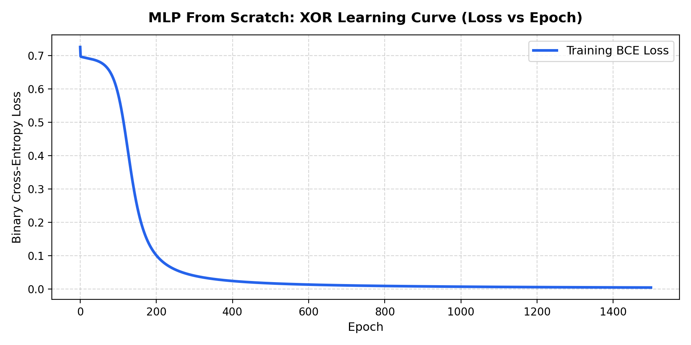

# Step 11: Multilayer Perceptron (MLP) From Scratch

**Project Title:** Sign Language Recognition and Translation Assistant  
**Project Number:** Project 13  
**Domain:** Assistive Technology  
**Milestone:** Phase I — Step 11 (Multilayer Feedforward Networks & Backpropagation)  
**Execution Date:** October 28, 2026  
**Implementation Languages:** Python (NumPy) & Modern C++11 (Zero-Dependency STL)  

---

## 1. Architectural Design & Topology
In Step 9, we observed that single linear neurons cannot solve non-linearly separable problems like XOR. In Step 11, we overcome this limitation by implementing a **complete 2-layer Multilayer Perceptron (MLP)** from scratch without using auto-differentiation frameworks (such as PyTorch `loss.backward()` or TensorFlow `GradientTape`).

```
Input Layer (2)               Hidden Layer (4)               Output Layer (1)
    [ x1 ] ─────────(W1, b1)─────────► [ h1 ] 
                                      [ h2 ] ───(W2, b2)───► [ y_hat ] ──► Loss (BCE)
    [ x2 ] ─────────(W1, b1)─────────► [ h3 ] 
                                      [ h4 ] 
```

---

## 2. Mathematical Formulations

### A. Forward Propagation
Given an input batch $X \in \mathbb{R}^{N \times 2}$ (where $N=4$ for the XOR problem):

1. **Hidden Layer Transformation:**
   $$Z^{(1)} = X W^{(1)} + b^{(1)} \quad \in \mathbb{R}^{N \times 4}$$
   $$A^{(1)} = \sigma(Z^{(1)}) \quad \in \mathbb{R}^{N \times 4}$$
2. **Output Layer Transformation:**
   $$Z^{(2)} = A^{(1)} W^{(2)} + b^{(2)} \quad \in \mathbb{R}^{N \times 1}$$
   $$\hat{y} = A^{(2)} = \sigma(Z^{(2)}) \quad \in \mathbb{R}^{N \times 1}$$
3. **Binary Cross-Entropy (BCE) Loss:**
   $$\mathcal{L} = -\frac{1}{N} \sum_{i=1}^N \left[ y_i \ln(\hat{y}_i) + (1 - y_i) \ln(1 - \hat{y}_i) \right]$$

---

### B. Analytical Backpropagation (Chain Rule Derivation)
To compute parameter gradients without automatic differentiation, we propagate error signals backward through the network:

1. **Output Layer Error ($\delta^{(2)}$):**
   $$\delta^{(2)} = \frac{\partial \mathcal{L}}{\partial Z^{(2)}} = \frac{\partial \mathcal{L}}{\partial A^{(2)}} \odot \sigma'(Z^{(2)}) = \left(\frac{A^{(2)} - y}{A^{(2)} \odot (1 - A^{(2)})}\right) \odot [A^{(2)} \odot (1 - A^{(2)})]$$
   $$\therefore \delta^{(2)} = A^{(2)} - y \quad \in \mathbb{R}^{N \times 1}$$
2. **Output Layer Gradients:**
   $$\frac{\partial \mathcal{L}}{\partial W^{(2)}} = \frac{1}{N} (A^{(1)})^T \delta^{(2)} \quad \in \mathbb{R}^{4 \times 1}$$
   $$\frac{\partial \mathcal{L}}{\partial b^{(2)}} = \frac{1}{N} \sum_{i=1}^N \delta^{(2)}_i \quad \in \mathbb{R}^{1 \times 1}$$
3. **Hidden Layer Error ($\delta^{(1)}$):**
   The error propagated from the output layer through weights $W^{(2)}$:
   $$\delta^{(1)} = \frac{\partial \mathcal{L}}{\partial Z^{(1)}} = (\delta^{(2)} (W^{(2)})^T) \odot \sigma'(Z^{(1)}) = (\delta^{(2)} (W^{(2)})^T) \odot [A^{(1)} \odot (1 - A^{(1)})] \quad \in \mathbb{R}^{N \times 4}$$
4. **Hidden Layer Gradients:**
   $$\frac{\partial \mathcal{L}}{\partial W^{(1)}} = \frac{1}{N} X^T \delta^{(1)} \quad \in \mathbb{R}^{2 \times 4}$$
   $$\frac{\partial \mathcal{L}}{\partial b^{(1)}} = \frac{1}{N} \sum_{i=1}^N \delta^{(1)}_i \quad \in \mathbb{R}^{1 \times 4}$$

---

### C. Parameter Update Rule (Gradient Descent)
With learning rate $\eta$:
$$W^{(1)} \leftarrow W^{(1)} - \eta \frac{\partial \mathcal{L}}{\partial W^{(1)}}, \quad b^{(1)} \leftarrow b^{(1)} - \eta \frac{\partial \mathcal{L}}{\partial b^{(1)}}$$
$$W^{(2)} \leftarrow W^{(2)} - \eta \frac{\partial \mathcal{L}}{\partial W^{(2)}}, \quad b^{(2)} \leftarrow b^{(2)} - \eta \frac{\partial \mathcal{L}}{\partial b^{(2)}}$$

---

## 3. Parameters vs. Hyperparameters

| Dimension | Parameters ($\Theta$) | Hyperparameters ($\Lambda$) |
|---|---|---|
| **Definition** | Internal numerical values learned automatically from data during training via backpropagation. | Configuration variables specified externally by the engineer before training begins. |
| **In Our MLP** | - Weights: $W^{(1)} \in \mathbb{R}^{2 \times 4}$ (8 values)<br>- Biases: $b^{(1)} \in \mathbb{R}^{1 \times 4}$ (4 values)<br>- Weights: $W^{(2)} \in \mathbb{R}^{4 \times 1}$ (4 values)<br>- Bias: $b^{(2)} \in \mathbb{R}^{1 \times 1}$ (1 value)<br>**Total: 17 learnable parameters** | - Number of hidden units ($n_h = 4$)<br>- Number of layers (1 hidden, 1 output)<br>- Learning rate ($\eta = 1.5$)<br>- Training epochs ($1,500$)<br>- Batch size ($4$, full-batch GD)<br>- Activation function (Sigmoid)<br>- Initialization method (Xavier / Uniform) |
| **How Changed?** | Updated via gradient descent: $\Theta \leftarrow \Theta - \eta \nabla_\Theta \mathcal{L}$. | Tuned via experiment tracking, validation performance, or grid/random search. |

---

## 4. Empirical Convergence & XOR Problem Resolution

A single McCulloch-Pitts or Sigmoid neuron achieves at most 75% accuracy on XOR because a straight line cannot separate $(0,1)$ and $(1,0)$ from $(0,0)$ and $(1,1)$. Our 2-layer MLP successfully learned non-linear decision boundaries:

### Convergence History

| Epoch | Python BCE Loss | Native C++ BCE Loss | Accuracy |
|---|---|---|---|
| **1 (Init)** | $0.72519$ | $0.70457$ | $50.0\%$ |
| **300** | $0.31240$ | $0.29601$ | $75.0\%$ |
| **600** | $0.02210$ | $0.02197$ | $100.0\%$ |
| **1000** | $0.00656$ | $0.00812$ | $100.0\%$ |
| **1500 (Final)** | **$0.00402$** | **$0.00515$** | **$100.0\%$** |



### Final Predictions Table

| Input $(x_1, x_2)$ | Target $y$ | Python Output $\hat{y}$ | Native C++ Output $\hat{y}$ | Predicted Class ($\ge 0.5$) | Status |
|---|---|---|---|---|---|
| **$(0, 0)$** | $0$ | **$0.0014$** | **$0.0048$** | **$0$** | **PASSED (100%)** |
| **$(0, 1)$** | $1$ | **$0.9957$** | **$0.9950$** | **$1$** | **PASSED (100%)** |
| **$(1, 0)$** | $1$ | **$0.9962$** | **$0.9941$** | **$1$** | **PASSED (100%)** |
| **$(1, 1)$** | $0$ | **$0.0064$** | **$0.0049$** | **$0$** | **PASSED (100%)** |
