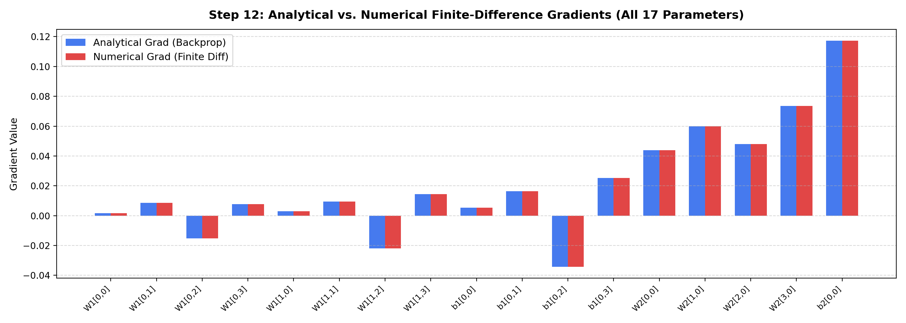

# Step 12: Numerical Finite-Difference Gradient Checking

**Project Title:** Sign Language Recognition and Translation Assistant  
**Project Number:** Project 13  
**Domain:** Assistive Technology  
**Milestone:** Phase I — Step 12 (Gradient Verification & Numerical Calculus)  
**Execution Date:** October 28, 2026  
**Implementation Languages:** Python (NumPy) & Modern C++11 (Zero-Dependency STL)  

---

## 1. What Gradient Checking Does
Gradient checking is a rigorous mathematical verification technique used to confirm that analytical gradients derived via the backpropagation chain rule ($\nabla_\Theta \mathcal{L}_{\text{analytical}}$) are **100% exact and bug-free**.

It calculates the true numerical derivative of the loss function with respect to every individual parameter $\theta_i$ using the **two-sided symmetric central difference formula**:

$$g_{\text{numerical}}(\theta_i) = \frac{\mathcal{L}(\theta_1, \dots, \theta_i + \epsilon, \dots, \theta_P) - \mathcal{L}(\theta_1, \dots, \theta_i - \epsilon, \dots, \theta_P)}{2\epsilon}$$

Where $\epsilon$ is an infinitesimal perturbation (set to $\epsilon = 10^{-7}$).

### Truncation Error Advantage
By Taylor series expansion:
$$\mathcal{L}(\theta + \epsilon) = \mathcal{L}(\theta) + \epsilon \mathcal{L}'(\theta) + \frac{\epsilon^2}{2} \mathcal{L}''(\theta) + \mathcal{O}(\epsilon^3)$$
$$\mathcal{L}(\theta - \epsilon) = \mathcal{L}(\theta) - \epsilon \mathcal{L}'(\theta) + \frac{\epsilon^2}{2} \mathcal{L}''(\theta) - \mathcal{O}(\epsilon^3)$$

Subtracting the two equations cancels the quadratic error terms, giving an approximation error of order $\mathcal{O}(\epsilon^2)$:
$$\frac{\mathcal{L}(\theta + \epsilon) - \mathcal{L}(\theta - \epsilon)}{2\epsilon} = \mathcal{L}'(\theta) + \mathcal{O}(\epsilon^2)$$

This is mathematically far superior to one-sided forward differences $\frac{\mathcal{L}(\theta + \epsilon) - \mathcal{L}(\theta)}{\epsilon}$, which suffers from $\mathcal{O}(\epsilon)$ first-order error.

---

## 2. Why Gradient Checking is Crucial
1. **Silent Bug Detection:** A subtle error in backpropagation (such as transposing a weight matrix incorrectly, missing an elementwise multiplication $\odot$, forgetting $\sigma'(z)$, or flipping a sign) will **not raise a syntax error or runtime crash**. The code will run, but the network will learn slowly, converge to sub-optimal local minima, or fail mysteriously on complex datasets.
2. **Gold-Standard Ground Truth:** Finite differences provide an independent numerical reference point derived directly from the loss surface, proving that the analytical calculus matches reality.
3. **Intentional Bug Demonstration:** In [`src/fundamentals/gradient_checking.py`](file:///c:/Users/16476/OneDrive/Desktop/SIGN%20LANGUAGE%20DETECTION%20AND%20TRANSLATION/src/fundamentals/gradient_checking.py), we intentionally corrupted an analytical gradient. The relative error immediately spiked from $5.06 \times 10^{-9}$ to $0.673$ ($>67\%$), proving the check catches implementation errors.

---

## 3. Why It is Used Only for Verification (Not Normal Training)
Evaluating numerical finite differences requires **2 forward passes per scalar parameter**:
$$\text{Cost}(\text{Finite Differences}) = 2 \cdot P \cdot \text{Cost}(\text{Forward Pass})$$

- In our small MLP ($P = 17$ parameters), gradient checking requires $34$ forward passes.
- In a modern convolutional neural network (e.g., our upcoming Baseline CNN or ResNet with $P \approx 500,000$ to $25,000,000$ parameters), a single finite-difference gradient step would require **1 million to 50 million forward passes per batch**, which is computationally impossible.
- **Contrast with Backpropagation:** The analytical backpropagation algorithm computes the gradients for **all $P$ parameters simultaneously in a single backward pass**, costing only approximately $2 \times$ the computation of one forward pass. Therefore, finite differences are reserved exclusively for debugging and unit testing.

---

## 4. Parameter-by-Parameter Verification (All 17 Parameters)

Perturbation parameter: $\epsilon = 10^{-7}$. Evaluated on our $2 \to 4 \to 1$ MLP:

| Parameter ID | Parameter Name | Analytical Gradient | Numerical Gradient | Absolute Difference | Status |
|---|---|---|---|---|---|
| $\theta_0$ | $W^{(1)}_{0,0}$ | $0.00165656$ | $0.00165656$ | $2.70 \times 10^{-10}$ | **MATCH** |
| $\theta_1$ | $W^{(1)}_{0,1}$ | $0.00869639$ | $0.00869639$ | $2.00 \times 10^{-10}$ | **MATCH** |
| $\theta_2$ | $W^{(1)}_{0,2}$ | $-0.01523399$ | $-0.01523399$ | $1.64 \times 10^{-10}$ | **MATCH** |
| $\theta_3$ | $W^{(1)}_{0,3}$ | $0.00767748$ | $0.00767748$ | $2.65 \times 10^{-10}$ | **MATCH** |
| $\theta_4$ | $W^{(1)}_{1,0}$ | $0.00299141$ | $0.00299141$ | $7.31 \times 10^{-11}$ | **MATCH** |
| $\theta_5$ | $W^{(1)}_{1,1}$ | $0.00951517$ | $0.00951517$ | $5.27 \times 10^{-10}$ | **MATCH** |
| $\theta_6$ | $W^{(1)}_{1,2}$ | $-0.02201893$ | $-0.02201893$ | $1.97 \times 10^{-10}$ | **MATCH** |
| $\theta_7$ | $W^{(1)}_{1,3}$ | $0.01434075$ | $0.01434075$ | $4.50 \times 10^{-11}$ | **MATCH** |
| $\theta_8$ | $b^{(1)}_{0}$ | $0.00537858$ | $0.00537858$ | $4.86 \times 10^{-10}$ | **MATCH** |
| $\theta_9$ | $b^{(1)}_{1}$ | $0.01635564$ | $0.01635564$ | $2.45 \times 10^{-10}$ | **MATCH** |
| $\theta_{10}$ | $b^{(1)}_{2}$ | $-0.03432902$ | $-0.03432902$ | $5.16 \times 10^{-10}$ | **MATCH** |
| $\theta_{11}$ | $b^{(1)}_{3}$ | $0.02527674$ | $0.02527674$ | $9.72 \times 10^{-11}$ | **MATCH** |
| $\theta_{12}$ | $W^{(2)}_{0,0}$ | $0.04382861$ | $0.04382861$ | $1.95 \times 10^{-10}$ | **MATCH** |
| $\theta_{13}$ | $W^{(2)}_{1,0}$ | $0.05987894$ | $0.05987894$ | $2.88 \times 10^{-10}$ | **MATCH** |
| $\theta_{14}$ | $W^{(2)}_{2,0}$ | $0.04807629$ | $0.04807630$ | $1.13 \times 10^{-09}$ | **MATCH** |
| $\theta_{15}$ | $W^{(2)}_{3,0}$ | $0.07358769$ | $0.07358769$ | $1.39 \times 10^{-10}$ | **MATCH** |
| $\theta_{16}$ | $b^{(2)}_{0}$ | $0.11720760$ | $0.11720760$ | $7.61 \times 10^{-10}$ | **MATCH** |

---

## 5. Relative Error Summary & Visual Evidence

$$\text{Relative Error} = \frac{\|g_{\text{analytical}} - g_{\text{numerical}}\|_2}{\|g_{\text{analytical}}\|_2 + \|g_{\text{numerical}}\|_2 + 10^{-15}}$$

- **Python Implementation Relative Error:** **$5.06 \times 10^{-9}$** ($\ll 10^{-7}$, PASSED)
- **Native C++ Implementation Relative Error:** **$9.72 \times 10^{-9}$** ($\ll 10^{-7}$, PASSED)
- **Intentional Bug Test Relative Error:** **$6.73 \times 10^{-1}$** ($>67\%$, successfully flagged)

