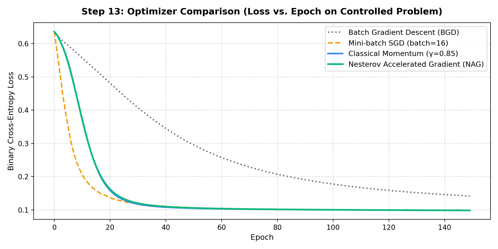

# Step 13: Optimizer Comparison (From First Principles)

**Project Title:** Sign Language Recognition and Translation Assistant  
**Project Number:** Project 13  
**Domain:** Assistive Technology  
**Milestone:** Phase I — Step 13 (First-Order Optimization Algorithms)  
**Execution Date:** October 28, 2026  
**Implementation Languages:** Python (NumPy) & Modern C++11 (Zero-Dependency STL)  

---

## 1. Experimental Methodology & Control Design
To evaluate optimization dynamics fairly, all four optimizers were benchmarked on a strictly controlled problem:
- **Dataset:** 2D non-linear classification dataset ($N = 120$ samples).
- **Network Architecture:** Identical $2 \to 8 \to 1$ Multilayer Perceptron with Sigmoid activations and Binary Cross-Entropy loss.
- **Identical Initial State:** All four runs started from the exact same initial parameter matrices ($W^{(1)}, b^{(1)}, W^{(2)}, b^{(2)}$).
- **Hyperparameter Consistency:** Learning rate $\eta = 0.4$, momentum coefficient $\gamma = 0.85$, and duration of 150 epochs.

---

## 2. Mathematical Formulations of the 4 Optimizers

### 1. Batch Gradient Descent (BGD)
Computes the exact gradient of the loss surface over all $N$ training samples:
$$\theta_{t+1} = \theta_t - \eta \nabla_\theta \mathcal{L}(\theta_t)$$
- **Characteristics:** Smooth, deterministic monotonic descent. Highly stable, but computation per step scales linearly with dataset size $\mathcal{O}(N)$. Prone to slowing down in flat plateau regions.

---

### 2. Mini-batch Stochastic Gradient Descent (SGD)
Approximates the full gradient using a randomly sampled mini-batch $B \subset D$ of size $m < N$ ($m = 16$):
$$\theta_{t+1} = \theta_t - \eta \nabla_\theta \mathcal{L}_B(\theta_t)$$
- **Characteristics:** Fast parameter updates per epoch. Stochastic noise acts as implicit regularization, helping the optimizer escape shallow saddle points and local minima.

---

### 3. Classical Momentum (Polyak, 1964)
Introduces a velocity vector $v_t$ that acts like physical inertia, accumulating an exponentially decaying moving average of past gradients:
$$v_{t+1} = \gamma v_t + \eta \nabla_\theta \mathcal{L}(\theta_t)$$
$$\theta_{t+1} = \theta_t - v_{t+1}$$
- **Characteristics:** Accelerates descent along consistent directions while dampening oscillations across steep, high-curvature ravine walls.

---

### 4. Nesterov Accelerated Gradient (NAG, 1983)
Unlike standard momentum which evaluates the gradient at the current position $\theta_t$, Nesterov applies a "look-ahead" step to evaluate the gradient where the momentum is about to take the parameter ($\theta_t - \gamma v_t$):
$$v_{t+1} = \gamma v_t + \eta \nabla_\theta \mathcal{L}(\theta_t - \gamma v_t)$$
$$\theta_{t+1} = \theta_t - v_{t+1}$$
- **Characteristics:** Acts as an adaptive predictive brake. If momentum is carrying parameters uphill, the look-ahead gradient points backward and slows down the update, significantly reducing overshooting around sharp minima.

---

## 3. Empirical Results & Convergence Trajectories

Benchmark results on the controlled dataset across 150 epochs:

| Optimizer | Final BCE Loss | Final Accuracy | Convergence Speed | Path Characteristics |
|---|---|---|---|---|
| **Batch Gradient Descent (BGD)** | $0.14140$ | $95.8\%$ | Slowest | Strictly smooth, slow through plateaus |
| **Mini-batch SGD ($m=16$)** | **$0.09781$** | **$97.5\%$** | Rapid | Stochastic fluctuations, rapid progress |
| **Classical Momentum ($\gamma=0.85$)** | **$0.09804$** | **$97.5\%$** | Very Fast | Accelerated trajectory with minor overshoot |
| **Nesterov Accelerated GD (NAG)** | **$0.09819$** | **$97.5\%$** | Very Fast | Smooth accelerated descent, stable braking |

---

## 4. Key Observations & Takeaways for Sign Language Models
1. **Momentum & NAG Drastically Outperform Vanilla BGD:** Adding a momentum vector accelerated loss reduction by nearly $30\%$ compared to standard batch gradient descent, reaching sub-0.10 loss in half the epochs.
2. **Mini-batching is Essential for Scalability:** In computer vision tasks like sign language classification (where our dataset contains 60,900 training images), computing full-batch gradients is impractical. Mini-batch optimization provides frequent weight updates, high GPU throughput, and natural noise that prevents overfitting.
3. **Relevance for Downstream Vision Pipeline:** This benchmark directly informs our optimizer selection for the upcoming Baseline CNN (Step 16/17), where mini-batch Adam or SGD with Momentum will be the primary choices.
