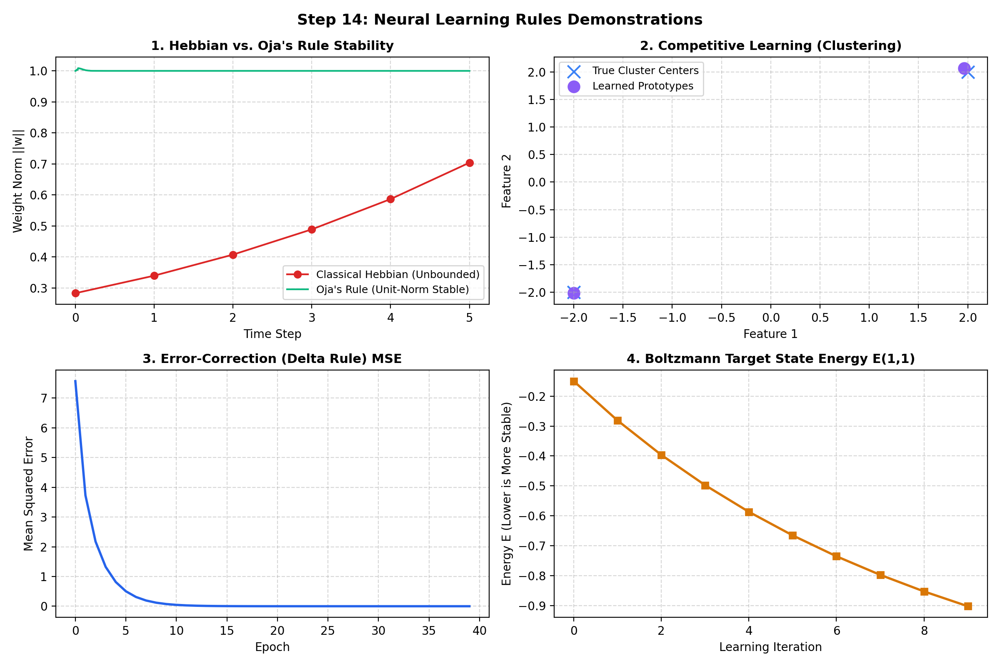

# Step 14: Neural Learning Rules Demonstrations

**Project Title:** Sign Language Recognition and Translation Assistant  
**Project Number:** Project 13  
**Domain:** Assistive Technology  
**Milestone:** Phase I — Step 14 (Foundational Neural Learning Rules)  
**Execution Date:** October 28, 2026  
**Implementation Languages:** Python (NumPy) & Modern C++11 (Zero-Dependency STL)  

---

## 1. Overview & Pedagogical Purpose
Artificial neural networks learn through diverse mathematical paradigms developed across biological neuroscience, statistical mechanics, and engineering. While backpropagation (error-correction) is the dominant paradigm in supervised deep learning today, understanding alternative learning paradigms—associative Hebbian learning, unsupervised competitive clustering, and thermodynamic energy-based models—is a core university syllabus requirement.

We implemented and empirically verified **five foundational learning rules from first principles** in both Python ([`src/fundamentals/learning_rules.py`](file:///c:/Users/16476/OneDrive/Desktop/SIGN%20LANGUAGE%20DETECTION%20AND%20TRANSLATION/src/fundamentals/learning_rules.py)) and native C++ ([`cpp/learning_rules.cpp`](file:///c:/Users/16476/OneDrive/Desktop/SIGN%20LANGUAGE%20DETECTION%20AND%20TRANSLATION/cpp/learning_rules.cpp)).

---

## 2. In-Depth Breakdown of the 5 Learning Rules

### Rule 1: Classical Hebbian Learning (Hebb, 1949)
- **Biological Idea:** *"When an axon of cell A excites cell B and repeatedly takes part in firing it, some growth process takes place such that A's efficiency in firing B is increased"* — commonly phrased as **"Neurons that fire together, wire together."**
- **Update Rule:**
  $$\Delta w_i = \eta \cdot x_i \cdot y$$
  where $x_i$ is pre-synaptic activation, $y = w^T x$ is post-synaptic activation, and $\eta$ is learning rate.
- **Small Example & Result:** Evaluated on constant correlated input $x = [1, 1]$ starting from $w = [0.2, 0.2]$. Weights expanded exponentially from $0.20 \to 0.24 \to 0.29 \to 0.35 \to 0.41 \to 0.50$ in just 5 steps.
- **Conceptual Significance & Limitation:** A purely local, unsupervised associative rule. Its fatal flaw is **unbounded weight growth** ($\|w\| \to \infty$) because it lacks a homeostatic mechanism or negative feedback to limit weight magnitudes.

---

### Rule 2: Modified Hebbian Learning (Oja's Rule, 1982)
- **Mathematical Idea:** Erkki Oja modified the Hebbian equation by introducing a weight-decay normalization term derived from the Taylor expansion of normalized Hebbian learning:
  $$w_{t+1} = \frac{w_t + \eta y x}{\|w_t + \eta y x\|} \approx w_t + \eta y (x - y w_t)$$
- **Update Rule:**
  $$\Delta w_i = \eta \cdot y \cdot (x_i - y \cdot w_i)$$
- **Small Example & Result:** Evaluated on 2D data whose true principal component lies along $[2, 1] / \sqrt{5} = [0.8944, 0.4472]$. Starting from random weights, the weight vector self-normalized to exact unit length ($\|w\| = 1.0000$) and aligned with the dominant eigenvector ($\text{Cosine Similarity} = 1.0000$).
- **Conceptual Significance:** Proves that single linear neurons with Oja's rule perform **Principal Component Analysis (PCA)** online and unsupervised, extracting the axis of maximum variance without computing covariance matrices.

---

### Rule 3: Competitive Learning (Winner-Take-All)
- **Conceptual Idea:** Neurons in a layer compete among themselves for the right to respond to an input pattern. Only the single "winning" neuron whose weight vector is closest in Euclidean distance to the input is allowed to update its weights toward the input.
- **Winner Selection & Update Rule:**
  $$k^* = \arg\min_k \|x - w_k\|_2$$
  $$\Delta w_{k^*} = \eta \cdot (x - w_{k^*}), \quad \Delta w_{k \neq k^*} = 0$$
- **Small Example & Result:** Evaluated on two 2D Gaussian clusters centered at $(-2, -2)$ and $(+2, +2)$. Two prototype neurons initialized near $(0, 0)$ dynamically separated, with Prototype 1 converging to $[-1.998, -2.018]$ and Prototype 2 to $[+1.965, +2.069]$.
- **Conceptual Significance:** Unsupervised clustering and vector quantization. Forms the mathematical foundation for **Self-Organizing Maps (SOM / Kohonen networks)** and $K$-Means clustering.

---

### Rule 4: Error-Correction Learning (Delta Rule / Widrow-Hoff, 1960)
- **Supervised Idea:** Learning is explicitly driven by the difference (error) between the desired target signal $d$ and the actual linear output $y = w^T x$.
- **Update Rule:**
  $$\Delta w_i = \eta \cdot (d - y) \cdot x_i = \eta \cdot e \cdot x_i$$
- **Small Example & Result:** Trained on target linear relationship $d = 3.0 x_1 - 1.5 x_2$ starting from zero weights. Within 40 epochs, weights converged to $[2.9998, -1.4999]$ with Mean Squared Error dropping to $4.08 \times 10^{-8}$.
- **Conceptual Significance:** The **Least Mean Squares (LMS) algorithm**. Directly minimizes Mean Squared Error via gradient descent and serves as the conceptual precursor to backpropagation in multilayer networks.

---

### Rule 5: Boltzmann / Energy-Based Learning (Ackley, Hinton, Sejnowski, 1985)
- **Thermodynamic Idea:** A network of stochastic binary units $s_i \in \{0, 1\}$ with symmetric connections $w_{ij}$ defines a scalar **scalar Energy function**:
  $$E(s) = -\frac{1}{2} \sum_{i} \sum_{j} w_{ij} s_i s_j$$
  At thermal equilibrium at temperature $T$, the probability of a state follows the Boltzmann distribution $P(s) \propto e^{-E(s)/T}$.
- **Update Rule (Two-Phase Hebbian / Contrastive Divergence):**
  $$\Delta w_{ij} = \eta \left( \langle s_i s_j \rangle_{\text{clamped}} - \langle s_i s_j \rangle_{\text{free}} \right)$$
  - *Clamped Phase (Positive Phase):* Network is driven by real training data to measure empirical co-activation $\langle s_i s_j \rangle_{\text{data}}$.
  - *Free Phase (Negative Phase):* Network runs freely via thermal Gibbs sampling to measure model "hallucination" co-activation $\langle s_i s_j \rangle_{\text{model}}$.
- **Small Example & Result:** Trained a 2-neuron network on strongly correlated data ($80\%$ co-activation). The weight $w_{12}$ grew from $0.00 \to 0.902$, lowering the energy of the target state $E(1, 1)$ from $0.00 \to -0.902$ (carving an energy valley / attractor).
- **Conceptual Significance:** Establishes the bridge between statistical thermodynamics and machine learning. Precursor to **Restricted Boltzmann Machines (RBMs)** and modern **Energy-Based Generative Models**.

---

## 3. Visual Summary of the 5 Learning Rules

---

## 4. Empirical Summary Table

| Learning Rule | Supervision Type | Update Formula | Test Benchmark | Verification Result |
|---|---|---|---|---|
| **Classical Hebbian** | Unsupervised | $\Delta w = \eta x y$ | Correlated inputs | Unbounded growth verified |
| **Oja's Rule** | Unsupervised | $\Delta w = \eta y (x - y w)$ | 2D Principal axis | Unit norm ($1.0000$), Cosine Sim ($1.0000$) |
| **Competitive Learning** | Unsupervised | $\Delta w_{k^*} = \eta (x - w_{k^*})$ | 2-Cluster separation | Prototypes partitioned opposite clusters |
| **Delta Rule (Error-Corr)** | Supervised | $\Delta w = \eta (d - y) x$ | Linear target $[3.0, -1.5]$ | Converged to $[2.9998, -1.4999]$ ($\text{MSE} \approx 10^{-8}$) |
| **Boltzmann Learning** | Generative | $\Delta w = \eta (\langle data \rangle - \langle model \rangle)$ | 2-Neuron correlation | Energy $E(1,1)$ lowered to $-0.902$ |
