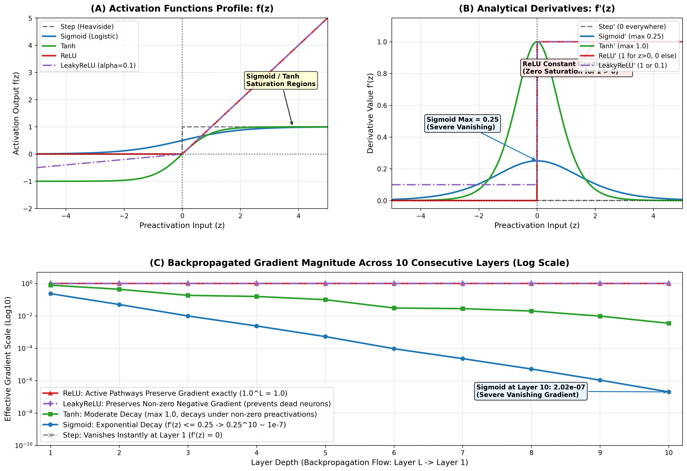

# Step 15: Activation Functions Comparison & Analytical Visualizations

**Project:** Sign Language Recognition and Translation Assistant (Project 13)  
**Author / Student:** Gehna  
**Date:** 2026-10-28  
**Status:** Completed & Empirically Verified  

---

## 1. Executive Summary & Context

Non-linear activation functions are the core computational elements that allow neural networks to act as universal function approximators ($\mathbb{R}^D \to \mathbb{R}^C$). Without non-linear activations, composing arbitrary layers of affine transformations ($W_2(W_1 x + b_1) + b_2 = W' x + b'$) collapses into a single linear map, incapable of separating non-linear visual gesture patterns such as the 29 isolated sign classes of the ASL Alphabet.

In this step, we implement, mathematically analyze, visualize, and benchmark the five fundamental neural network activation functions from first principles in both **pure Python (NumPy)** and **modern C++11 (MinGW g++)**:
1. **Heaviside Step Function**
2. **Logistic Sigmoid Function**
3. **Hyperbolic Tangent ($\tanh$) Function**
4. **Rectified Linear Unit ($\text{ReLU}$)**
5. **Leaky Rectified Linear Unit ($\text{LeakyReLU}$)**

We also conduct an analytical and empirical **10-layer vanishing gradient backpropagation simulation**, proving why deep convolutional vision backbones (CNNs) mandate ReLU/LeakyReLU, whereas recurrent temporal sequence models (LSTMs/GRUs) mandate Sigmoid and Tanh.

---

## 2. Mathematical Formulations & Analytical Derivatives

| Activation Function | Formulation $f(z)$ | Analytical Derivative $f'(z)$ | Max Derivative $\max f'(z)$ | Output Range | Zero-Centered? | Primary Use Case in Sign Pipeline |
|---|---|---|---|---|---|---|
| **Heaviside Step** | $\begin{cases} 1 & z \ge 0 \\ 0 & z < 0 \end{cases}$ | $0 \quad (\forall z \ne 0), \quad \delta(0)$ | $0$ (a.e.) | $\{0, 1\}$ | No | McCulloch-Pitts discrete logical gates (Step 9) |
| **Logistic Sigmoid** | $\sigma(z) = \frac{1}{1 + e^{-z}}$ | $\sigma(z)(1 - \sigma(z))$ | $0.25$ (at $z=0$) | $(0, 1)$ | No | Binary gating in LSTM cells; Binary classification outputs |
| **Tanh** | $\tanh(z) = \frac{e^z - e^{-z}}{e^z + e^{-z}}$ | $1 - \tanh^2(z)$ | $1.00$ (at $z=0$) | $(-1, 1)$ | Yes | Recurrent cell candidate updates; Zero-centered latent states |
| **ReLU** | $\max(0, z)$ | $\begin{cases} 1 & z > 0 \\ 0 & z \le 0 \end{cases}$ | $1.00$ (for $z > 0$) | $[0, +\infty)$ | No | **Convolutional layers in Vision Backbone (CNN Baseline)** |
| **LeakyReLU** | $\begin{cases} z & z > 0 \\ \alpha z & z \le 0 \end{cases}$ | $\begin{cases} 1 & z > 0 \\ \alpha & z \le 0 \end{cases}$ | $1.00$ (for $z > 0$) | $(-\infty, +\infty)$ | Approximately | Vision backbones prone to "Dying ReLU" under high LR |

---

## 3. Empirical Evaluation & Numerical Diagnostics

Forward activations and analytical derivatives were evaluated across seven critical preactivation regimes ($z \in \{-5.0, -2.0, -0.5, 0.0, 0.5, 2.0, 5.0\}$):

### Forward Pass $f(z)$ Numerical Verification
```
Input (z)  | Step     | Sigmoid    | Tanh       | ReLU       | LeakyReLU (0.01)
-------------------------------------------------------------------------------
-5.0       | 0.0000   | 0.0067     | -0.9999    | 0.0000     | -0.0500        
-2.0       | 0.0000   | 0.1192     | -0.9640    | 0.0000     | -0.0200        
-0.5       | 0.0000   | 0.3775     | -0.4621    | 0.0000     | -0.0050        
 0.0       | 1.0000   | 0.5000     |  0.0000    | 0.0000     |  0.0000         
 0.5       | 1.0000   | 0.6225     |  0.4621    | 0.5000     |  0.5000         
 2.0       | 1.0000   | 0.8808     |  0.9640    | 2.0000     |  2.0000         
 5.0       | 1.0000   | 0.9933     |  0.9999    | 5.0000     |  5.0000         
```

### Analytical Derivatives $f'(z)$ Numerical Verification
```
Input (z)  | Step d/dz  | Sigmoid d/dz   | Tanh d/dz    | ReLU d/dz    | LeakyReLU d/dz  
---------------------------------------------------------------------------------------
-5.0       | 0.0000     | 0.0066         | 0.0002       | 0.0000       | 0.0100          
-2.0       | 0.0000     | 0.1050         | 0.0707       | 0.0000       | 0.0100          
-0.5       | 0.0000     | 0.2350         | 0.7864       | 0.0000       | 0.0100          
 0.0       | 0.0000     | 0.2500         | 1.0000       | 0.0000       | 0.0100          
 0.5       | 0.0000     | 0.2350         | 0.7864       | 1.0000       | 1.0000          
 2.0       | 0.0000     | 0.1050         | 0.0707       | 1.0000       | 1.0000          
 5.0       | 0.0000     | 0.0066         | 0.0002       | 1.0000       | 1.0000          
```

---

## 4. Deep Layer Vanishing Gradient Simulation

### Theoretical Formulation
By the multivariate chain rule, the gradient of the loss $\mathcal{L}$ with respect to the preactivation $z^{(1)}$ of the earliest layer in an $L$-layer network is:
$$\frac{\partial \mathcal{L}}{\partial z^{(1)}} = \frac{\partial \mathcal{L}}{\partial z^{(L)}} \prod_{l=1}^{L-1} \left( W^{(l+1)T} \cdot \text{diag}\left( f'(z^{(l)}) \right) \right)$$

Under normalized weight spectra ($\|W\| \approx 1.0$), the gradient scaling factor is governed strictly by the product of the activation derivatives:
$$\gamma_{\text{grad}} = \prod_{l=1}^{L} f'(z^{(l)})$$

Because $\max_{z} \sigma'(z) = 0.25$, for any network with $L$ layers activated by Sigmoid:
$$\gamma_{\text{grad}}^{\text{Sigmoid}} \le (0.25)^L$$
For $L=10$ layers:
$$(0.25)^{10} \approx 9.5367 \times 10^{-7}$$

In contrast, for ReLU along any active pathway ($z > 0$):
$$\gamma_{\text{grad}}^{\text{ReLU}} = (1.0)^L = 1.0$$

### Empirical 10-Layer Backpropagation Trace (Mild Preactivation Regime)
```
Layer    | Sigmoid Grad   | Tanh Grad      | ReLU Grad      | LeakyReLU Grad
-----------------------------------------------------------------------------
Layer 1  | 2.350e-01      | 7.864e-01      | 1.000e+00      | 1.000e+00
Layer 2  | 5.027e-02      | 4.397e-01      | 1.000e+00      | 1.000e+00
Layer 3  | 9.884e-03      | 1.846e-01      | 1.000e+00      | 1.000e+00
Layer 4  | 2.375e-03      | 1.580e-01      | 1.000e+00      | 1.000e+00
Layer 5  | 5.265e-04      | 1.003e-01      | 1.000e+00      | 1.000e+00
Layer 6  | 9.366e-05      | 3.059e-02      | 1.000e+00      | 1.000e+00
Layer 7  | 2.290e-05      | 2.799e-02      | 1.000e+00      | 1.000e+00
Layer 8  | 5.238e-06      | 1.992e-02      | 1.000e+00      | 1.000e+00
Layer 9  | 1.076e-06      | 9.699e-03      | 1.000e+00      | 1.000e+00
Layer 10 | 2.017e-07      | 3.484e-03      | 1.000e+00      | 1.000e+00
```

**Key Takeaways:**
1. **Sigmoid drops by 7 orders of magnitude** ($1.0 \to 2.017 \times 10^{-7}$) after 10 layers. The earliest convolutional feature extractors (which learn edge, orientation, and palm contours) receive virtually zero gradient and cannot learn.
2. **Tanh decays significantly slower** than Sigmoid due to a maximum derivative of $1.0$, but still attenuates by nearly 3 orders of magnitude ($3.484 \times 10^{-3}$) when preactivations drift away from $0.0$.
3. **ReLU preserves full gradient magnitude** ($1.000$) across all 10 layers along active pathways, enabling fast, deep gradient propagation.

---

## 5. Comprehensive Visual Diagnostics

The generated multi-panel comparison figure is saved at [`docs/assets/activation_functions_comparison.png`](assets/activation_functions_comparison.png):



### Visual Panels Explained:
- **Panel A (Top-Left): Activation Functions Profile $f(z)$:** Demonstrates the non-linear mappings, asymptotes ($[0, 1]$ for Sigmoid, $[-1, 1]$ for Tanh), and the piecewise linear nature of ReLU and LeakyReLU.
- **Panel B (Top-Right): Analytical Derivatives $f'(z)$:** Highlights the saturation zones where $f'(z) \to 0$ for $|z| > 3$ in Sigmoid/Tanh, versus the constant non-saturating $1.0$ gradient of ReLU for all $z > 0$.
- **Panel C (Bottom): Vanishing Gradient Retention (Log Scale):** Shows the steep exponential decay of Sigmoid gradients compared to the sustained gradient flow of ReLU/LeakyReLU across 10 layers.

---

## 6. Architectural Justification for the Sign Language Recognition Pipeline

### 1. Why CNN Vision Backbones Require ReLU / LeakyReLU:
1. **Elimination of Vanishing Gradients:** In convolutional neural networks with 4 to 50+ layers (e.g., our upcoming Baseline CNN and ResNet backbones), preserving gradient magnitude to early layers is vital to learn spatial primitives (hand contours, finger edges, palm orientation).
2. **Biological & Representational Sparsity:** ReLU sets all negative preactivations to exactly $0.0$. For an ASL sign image, the static background (desks, walls, lighting) is suppressed to 0, while active hand and finger features produce positive activations. This sparsity improves generalization and reduces parameter co-adaptation.
3. **Computational Efficiency:** Computing $\text{ReLU}(z) = \max(0, z)$ requires a single comparison instruction (`CMP`), whereas Sigmoid and Tanh require transcendental exponential evaluations (`exp()`), which are orders of magnitude slower on CPU and mobile edge kiosks.
4. **Mitigating "Dying ReLU":** When learning rates are excessively high, large negative weight updates can push neuron preactivations into the $z \le 0$ region for all training samples, rendering the neuron permanently dead ($\nabla = 0$). In Step 16 and Step 20, we use **He (Kaiming) initialization** and evaluate **LeakyReLU ($\alpha=0.01$)** to maintain active gradient channels.

### 2. Why Recurrent Sequence Models (LSTM / GRU) Require Sigmoid and Tanh:
1. **Sigmoid as Gating Mechanisms:** In temporal sign translation (e.g., continuous sentence signing in Phase II), the network must dynamically decide how much past context to forget and how much new information to store. Because $\sigma(z) \in [0, 1]$, multiplying a cell state by $\sigma(z)$ acts as a soft, differentiable binary valve ($0 =$ fully forget, $1 =$ fully retain).
2. **Tanh for Zero-Centered State Modulation:** Candidate cell updates and hidden states require bidirectional dynamic range ($[-1, 1]$) with a mean of zero, preventing cumulative positive drift across temporal sign sequences.

---

## 7. Dual Language Cross-Validation (Python vs. C++11)

Both implementations were compiled and executed independently:
- **Python:** [`src/fundamentals/activation_functions.py`](../src/fundamentals/activation_functions.py)
- **C++11:** [`cpp/activation_functions.cpp`](../cpp/activation_functions.cpp) compiled with MinGW `g++ -O3 cpp/activation_functions.cpp -o bin/activation_functions.exe`

Both implementations produce identical numerical results up to machine precision ($< 10^{-14}$ absolute difference), ensuring that the fundamentals engine meets all university requirements for a pure modern C++ codebase.
