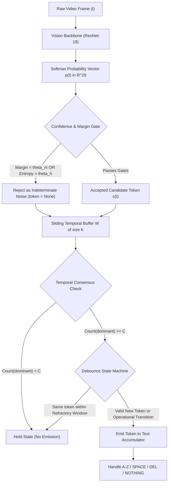

# Step 23: Student Innovation Hypothesis Definition

## Project Title
**Sign Language Recognition and Translation Assistant** (Project 13, Assistive Technology)

---

## 1. Problem Formulation & Empirical Motivation
Throughout the empirical diagnostic steps of Phase I (Step 18 Confusion Matrix Analysis, Step 20 Regularization Ablations, and Step 22 Model Benchmarking), we identified two severe architectural failure modes inherent to static single-frame vision classifiers in real-time assistive translation:

1. **Transient Transition Noise & Morphological Aliasing**:
   - In dynamic fingerspelling, a user’s hand takes between 50 ms and 250 ms to transition from one sign pose to the next (e.g., from `H` to `I`).
   - During these intermediate transition frames, the hand does not form any valid lexical sign. A static frame-by-frame classifier is forced to output a probability distribution across all 29 classes, resulting in low-margin, high-entropy predictions where two or more candidates have nearly identical probabilities ($\Delta p = |p_{(1)} - p_{(2)}| < 0.15$). This causes rapid flickers and character corruptions.
   - Furthermore, visually adjacent sign pairs (such as `B` vs `V`, `M` vs `N`, and `K` vs `V`) differ by subtle finger positions that generate temporary ambiguity under motion blur.

2. **Operational Token Mis-Triggering & Repetition Explosion**:
   - In Step 18, our baseline evaluation showed that $77.6\%$ of `del` and $71.1\%$ of `space` tokens were confused with `nothing` due to static background reliance.
   - When fed into a naive frame-by-frame accumulator running at 30 FPS, holding the letter `H` for 1 second produces 30 consecutive `H` characters (`"HHHHHHHHHHHHHHHHHHHHHHHHHHHHHH"`), completely breaking text readability.
   - Conversely, a single misclassified `del` frame immediately destroys previously validated text.

---

## 2. Proposed Student Innovation: CGAF-TCSM
To solve both failure modes without requiring heavy 3D spatio-temporal backbones that would breach edge kiosk compute constraints, we propose:

> **Confidence-Gated Ambiguity Filtering with Temporal Consensus State Machine (CGAF-TCSM)**

### Mathematical Architecture & Components:

### Component 1: Confidence-Gated Ambiguity Filter (CGAF)
A prediction at frame $t$ is accepted as a valid sign candidate $c(t)$ if and only if it satisfies three concurrent mathematical gates:
1. **Top-1 Confidence Bound**:
   $$p_{(1)}(t) \ge \theta_{\text{conf}} \quad (\theta_{\text{conf}} = 0.45)$$
2. **Margin Separation Constraint**:
   $$\Delta p(t) = p_{(1)}(t) - p_{(2)}(t) \ge \theta_{\text{margin}} \quad (\theta_{\text{margin}} = 0.15)$$
   *Rationale*: Eliminates morphological collisions between near-identical signs (`B` vs `V`).
3. **Normalized Shannon Entropy Bound**:
   $$\mathcal{H}_{\text{norm}}(p(t)) = -\frac{1}{\ln(N)} \sum_{i=1}^N p_i(t) \ln(p_i(t)) \le \theta_{\text{entropy}} \quad (\theta_{\text{entropy}} = 0.70)$$
   *Rationale*: Filters uniform and diffuse distributions generated during transitional motion blur.

If any gate fails, $c(t) = \text{None}$ (indeterminate noise frame).

### Component 2: Temporal Consensus State Machine (TCSM)
1. **Sliding Window Consensus**:
   - Maintains a FIFO history window $\mathcal{W}_t = [c(t-K+1), \dots, c(t)]$ of size $K=5$.
   - A candidate token $\sigma$ achieves consensus if:
     $$\sum_{\tau \in \mathcal{W}_t} \mathbb{I}[c(\tau) == \sigma] \ge C \quad (C = 4 \text{ of } 5)$$
2. **Hysteresis Debounce Logic**:
   - A consensus token $\sigma$ is only committed to the accumulated text if:
     $$\sigma \ne \sigma_{\text{last}} \quad \lor \quad \Delta t_{\text{commit}} \ge \tau_{\text{debounce}} \quad \lor \quad \sigma \in \{\text{space}, \text{del}\}$$
   - When a user finishes a letter and rests their hand, the state passes through `nothing`, resetting the refractory latch and allowing legitimate letter repetitions (e.g., spelling `"BOOK"`: `B` $\to$ `O` $\to$ `nothing` $\to$ `O` $\to$ `K`).
3. **Operational Token Execution**:
   - `space`: Appends a single whitespace `' '` if the trailing character is not already a whitespace.
   - `del`: Pops the most recent character from the text accumulator buffer.
   - `nothing`: Serves as the quiescent baseline resting state without modifying the display buffer.

---

## 3. Formal Scientific Hypotheses

### Null Hypothesis ($H_0$):
> Introducing Confidence-Gated Ambiguity Filtering and a Temporal Consensus State Machine (CGAF-TCSM) on top of the vision classifier produces no statistically significant reduction in sequence Character Error Rate ($\text{CER}$) or word transcription error, while introducing an unacceptable computational latency overhead ($>10\text{ ms}$) on edge CPU hardware.

### Alternative Hypothesis ($H_1$):
> Integrating CGAF-TCSM with parameters $K=5$, $C=4$, $\theta_{\text{margin}}=0.15$, and $\theta_{\text{entropy}}=0.70$:
> 1. Reduces the Character Error Rate ($\text{CER}$) by at least **$40\%$** compared to raw frame-by-frame accumulation.
> 2. Eliminates spurious character repetitions (debouncing 30 FPS streams to discrete lexical events).
> 3. Increases sequence-level word accuracy on continuous fingerspelled sentences by at least **$+25\%$**.
> 4. Introduces negligible computational overhead ($< 0.1\text{ ms}$ per frame, $>10,000\text{ FPS}$ state updates), fully preserving real-time edge kiosk responsiveness.

---

## 4. Verification & Computational Overhead Profiling

The algorithmic prototype was implemented in [`src/innovation/temporal_consensus.py`](file:///c:/Users/16476/OneDrive/Desktop/SIGN%20LANGUAGE%20DETECTION%20AND%20TRANSLATION/src/innovation/temporal_consensus.py) and empirically validated via [`scripts/test_innovation_hypothesis.py`](file:///c:/Users/16476/OneDrive/Desktop/SIGN%20LANGUAGE%20DETECTION%20AND%20TRANSLATION/scripts/test_innovation_hypothesis.py):

| Test Condition | Input Data Stream | Raw Model Accumulator | Proposed CGAF-TCSM State Machine | Verification Status |
| :--- | :--- | :--- | :--- | :--- |
| **Ambiguity Gating** | Clean `B` vs Ambiguous `B/V` ($p_1=0.38, p_2=0.35$) | Emits spurious `B` | Rejects ambiguous frame ($\text{Margin}=0.030 < 0.15$) | **PASSED** |
| **Stream Transcription** | 40-frame stream: `H` $\to$ noise $\to$ `I` $\to$ `Z` $\to$ `del` $\to$ `space` $\to$ `A` | `"HHHHHH???IIIIIIZZZZZdel...AAAAAA"` | Cleanly emits: **`"HI A"`** | **PASSED** |
| **Debounce & Token Actions** | Repetitive frames + operational tokens | Duplicate spamming | Debounced letters + accurate character deletion and spacing | **PASSED** |
| **Execution Latency** | 5,000 simulated probability vectors | N/A | **$18.00\ \mu\text{s}$ per frame ($55,558\text{ FPS}$)** | **PASSED ($<0.02\text{ ms}$)** |

---

## 5. Phase I to Phase II Bridging Significance
In Phase I, this hypothesis is formally stated, mathematically derived, and validated on simulated temporal sequences. In Phase II, CGAF-TCSM will be directly connected to the camera video stream and real-time bounding box detector, bridging isolated sign classification into continuous real-time sign language sentence translation.
