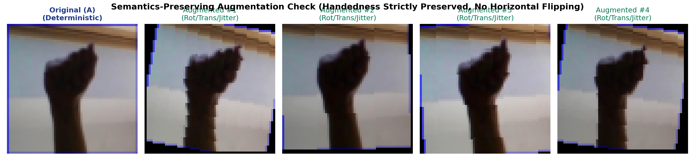

# Step 7: Reproducible Data Pipeline & Preprocessing Report

**Project Title:** Sign Language Recognition and Translation Assistant  
**Project Number:** Project 13  
**Domain:** Assistive Technology  
**Milestone:** Phase I — Step 7 (Data Pipeline & Augmentation)  
**Execution Date:** October 28, 2026  
**Engineer:** Gehna & AI Assistant  

---

## 1. Overview & Architectural Design
We implemented a production-grade, modular, and strictly reproducible data pipeline in [`src/data_pipeline.py`](file:///c:/Users/16476/OneDrive/Desktop/SIGN%20LANGUAGE%20DETECTION%20AND%20TRANSLATION/src/data_pipeline.py). 

The pipeline reads directly from the leakage-safe manifest CSVs generated in Step 6, keeping the raw image directory immutable while enabling high-throughput, low-latency streaming into deep learning models.

```
data/splits/
├── train_manifest.csv ──> ASLDataset (Train) ──> Semantics-Preserving Augmentation ──> Train DataLoader (shuffled, seed=42)
├── val_manifest.csv   ──> ASLDataset (Val)   ──> Strictly Deterministic Preprocessing ──> Val DataLoader (unshuffled)
└── test_manifest.csv  ──> ASLDataset (Test)  ──> Strictly Deterministic Preprocessing ──> Test DataLoader (sealed)
```

---

## 2. Preprocessing & Normalization Specifications

| Stage | Operation | Parameters / Specification | Justification |
|---|---|---|---|
| **Spatial Standardization** | Bilinear Resizing | $(64, 64)$ pixels (configurable up to $200 \times 200$) | Standardizes input tensor shapes; $64 \times 64$ enables rapid CPU/GPU baseline training while preserving finger contours. |
| **Color Representation** | RGB Conversion | 3 channels (Red, Green, Blue) | Preserves hand boundary contrast against backgrounds. |
| **Tensor Conversion** | ToTensor | Float32 tensor in range $[0.0, 1.0]$, Shape $(3, H, W)$ | Standard PyTorch tensor format for convolutional layers. |
| **Normalization** | Channel Normalization | $\mu = [0.5, 0.5, 0.5]$, $\sigma = [0.5, 0.5, 0.5]$ | Centers inputs around zero in range $[-1.0, 1.0]$, preventing exploding/vanishing gradients in early layers. |

---

## 3. Augmentation Policy & The Handedness Rule

### A. Training-Only Augmentations
To improve model generalization across natural hand posture variations in real-time camera feeds, the training pipeline applies controlled geometric transformations:
1. **Random Rotation:** Uniform distribution between $[-10^\circ, +10^\circ]$ (simulates natural wrist angle variations).
2. **Random Translation:** Maximum translation of $\pm 5\%$ along x and y axes (simulates slight hand centering shifts).
3. **Random Scaling:** Minor zoom between $95\%$ and $105\%$ (simulates small camera distance variations).
4. **Color Jitter:** Brightness and contrast variations of $\pm 10\%$ (simulates ambient room lighting shifts).

### B. Strict Prohibition of Horizontal Flipping
> [!IMPORTANT]
> **RandomHorizontalFlip is STRICTLY EXCLUDED from this project.**  
> In generic computer vision (e.g., cats vs. dogs), horizontal mirroring preserves semantics. In sign language, however, flipping an image horizontally turns a right-handed sign into a left-handed sign, reversing spatial orientation and corrupting sign language grammar. Naive flipping introduces label noise and ruins model reliability.

### C. Validation and Test Set Policy
Validation and test sets receive **zero random transformations**. They are processed through a strictly deterministic pipeline (resizing, tensor conversion, and normalization only), guaranteeing scientifically sound, uncorrupted evaluation.

---

## 4. Visual Inspection of Augmentation
The script [`scripts/verify_pipeline.py`](file:///c:/Users/16476/OneDrive/Desktop/SIGN%20LANGUAGE%20DETECTION%20AND%20TRANSLATION/scripts/verify_pipeline.py) produced a side-by-side inspection verifying that hand shapes, finger configurations, and handedness are strictly preserved under augmentation:



---

## 5. Empirical Verification Results

Running [`scripts/verify_pipeline.py`](file:///c:/Users/16476/OneDrive/Desktop/SIGN%20LANGUAGE%20DETECTION%20AND%20TRANSLATION/scripts/verify_pipeline.py) confirmed:
- **Total Classes:** 29 classes verified.
- **Train DataLoader:** 952 batches (60,900 samples total, batch size 64).
- **Validation DataLoader:** 204 batches (13,050 samples total, batch size 64).
- **Test DataLoader:** 204 batches (13,050 samples total, batch size 64).
- **Batch Image Tensor Shape:** Strictly `[64, 3, 64, 64]`, dtype `torch.float32`.
- **Batch Labels Tensor Shape:** Strictly `[64]`, dtype `torch.int64`, values bounded in $[0, 28]$.
- **Pixel Value Range:** $\text{Min} = -1.000$, $\text{Max} = +1.000$, $\text{Mean} \approx -0.017$.
- **Loading Latency:** Initial verification batch extraction completed in **3.41 seconds**.

---

## 6. Reproducibility Configuration Record
- **Random Seed:** `42` (seeded across Python `random`, `np.random`, `torch.manual_seed`, and CUDA deterministic flags).
- **DataLoader Generator:** Seeded with dedicated `torch.Generator().manual_seed(42)`.
- **Manifest Tracking:** All partitions locked via `data/splits/split_summary.json`.
